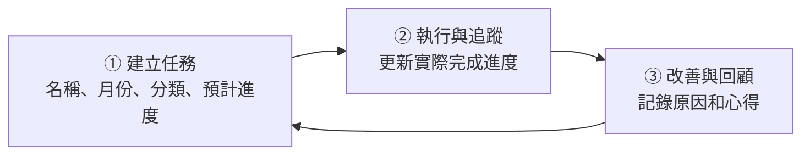

# Wee 簡約任務看板

簡潔的任務管理看板，協助你安排工作、追蹤進度，並記錄改善原因與回顧心得。

## Features

- **Task Management:** 新增任務並記錄任務名稱、月份和分類。
- **Planned Progress:** 為任務設定預計進度。
- **Progress Tracking:** 更新任務實際完成百分比。
- **Status Filters:** 依狀態查看全部、進行中或已完成的任務。
- **Monthly View:** 選擇月份查看任務。
- **Improvement Notes:** 記錄任務需要改善的原因。
- **Task Reviews:** 記錄完成任務後的回顧心得。
- **Local Storage:** 將任務資料保存在目前使用的瀏覽器。

## 瀏覽器需求

- 使用支援 JavaScript 的現代瀏覽器。
- 本看板不需要安裝額外套件或下載 AI 模型。
- 任務資料分別保存在各瀏覽器中，不會自動同步到其他瀏覽器或裝置。

## 快速開始

1. 開啟 [Wee 任務看板](https://huggingface.co/spaces/sony3021919/test)。
2. 選擇月份，輸入任務名稱、分類和預計進度。
3. 新增任務後，依照實際情況更新完成進度。
4. 使用狀態篩選查看全部、進行中或已完成的任務。
5. 視需要填寫改善原因和回顧心得。

## 系統流程

| 階段 | 記錄內容 | 用途 |
|---|---|---|
| ① 建立任務 | 任務名稱、月份、分類、預計進度 | 設定工作目標 |
| ② 執行與追蹤 | 實際完成進度、任務狀態 | 掌握任務進度 |
| ③ 改善與回顧 | 改善原因、回顧心得 | 留下經驗供之後參考 |

## 模組說明

### ① 任務建立

輸入任務名稱、月份、分類及預計進度，新增後即可在看板中查看和追蹤。

### ② 進度追蹤

依照實際情況更新任務的完成百分比，並使用狀態篩選查看任務。

### ③ 改善與回顧

在改善原因欄位記下執行過程中遇到的問題；任務完成後，可在回顧欄位留下心得。

## 架構

這是一個由 Hugging Face Spaces Static SDK 提供的靜態網頁應用程式。

1. **HTML** 提供任務表單、篩選控制項和任務看板。
2. **JavaScript** 處理任務新增、進度更新、篩選和畫面顯示。
3. **瀏覽器 localStorage** 將任務資料保存在目前使用的瀏覽器中。

## 資料保存與注意事項

- 任務資料保存在目前瀏覽器的本機儲存空間。
- 清除瀏覽器的網站資料可能會刪除已保存的任務。
- 換用其他瀏覽器或裝置時，任務資料不會自動轉移或同步。
- 任務資料不會因為提交程式到 GitHub 而備份到 GitHub。
- 請自行備份重要任務內容。

## 部署資訊

- **平台：** Hugging Face Spaces
- **SDK：** Static
- **網頁入口：** repository 根目錄的 `index.html`
